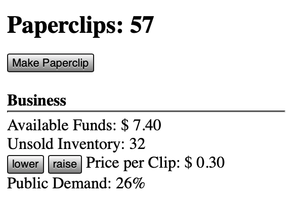

# Title of The Idea
A good pitch has a one-sentence version that explains the basic idea.

## Pitch
You should be able to develop this idea into a full paragraph that goes deeper into detail. Three sentences is usually enough. A good paragraph introduces a single idea, develops it, and then ends with a synthesis (or rewording) of that core idea.

## Lists
- Sometimes lists help you explore an idea
- Lists can collect a bunch of disparate ideas
- Lists can show possible variants of a common theme or concept

## Presentation
At 2026-10-19-16:00 we will open up each github process folder and go through each first idea.

- 5 minutes (or less) per idea
- You can put text, image(s), whatever

